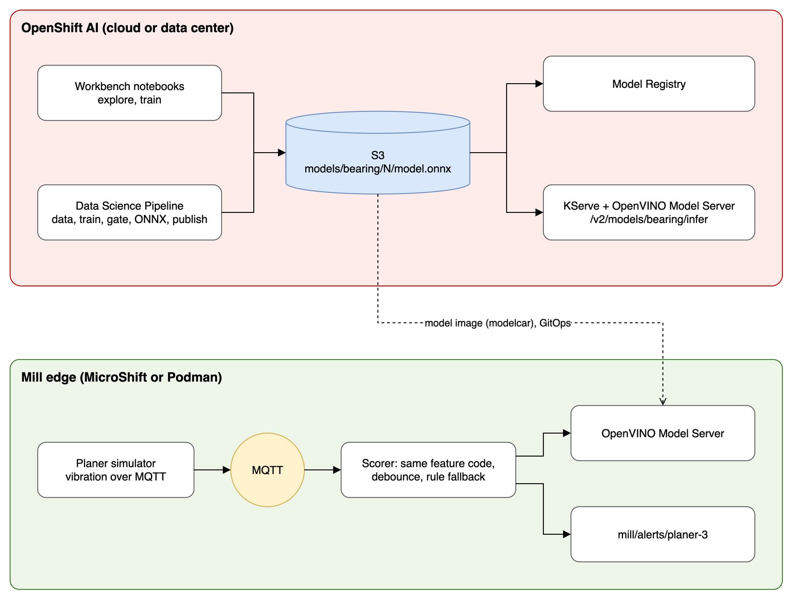

# Mill bearing failure prediction: OpenShift AI from notebook to edge

A hands-on Red Hat OpenShift AI demo built around an industrial story: **detect imbalance and bearing wear on a sawmill planer motor**, train the model centrally, and score it at the mill edge in milliseconds, even when the WAN or the model server goes down.

It follows the same steps as Red Hat's official fraud-detection tutorial (project, connections, workbench, train, ONNX, serve, pipeline), with an industrial model and an edge extension.



Source: [`docs/architecture.drawio`](docs/architecture.drawio) (open in [draw.io](https://app.diagrams.net) to edit, then re-export `docs/architecture.png`).

## What you will learn

| OpenShift AI skill | Where in this demo |
| --- | --- |
| Data science projects, connections (S3), workbenches | Setup, notebooks 1–2 |
| Training and evaluation in a notebook | `1_explore_and_train.ipynb` |
| Portable model format (ONNX) and the OVMS model layout | `2_export_upload_register.ipynb` |
| Model Registry (versions, metadata) | Notebook 2 and the pipeline (optional) |
| Model serving: KServe RawDeployment + OpenVINO Model Server, KServe v2 API | `openshift-ai/10-serving.yaml`, `3_test_endpoint.ipynb` |
| Data Science Pipelines with an evaluation gate | `pipelines/bearing_pipeline.py` |
| Edge inference with the same model and API | `edge/` (Podman compose or MicroShift) |

## Repository layout

```
src/bearing/            shared Python package (one source of truth for features)
  simulate.py           planer-motor physics: healthy, imbalance, bearing wear (BPFO impacts)
  features.py           RMS, peak, crest factor, kurtosis, 4 spectral bands, temperature, current
  model.py              scaler + small neural net; export to plain ONNX (Sub/Div/MatMul/Add/Relu/Softmax)
  storage.py            S3 upload using the connection's AWS_* variables
  registry.py           optional Model Registry registration
  inference.py          KServe v2 REST client + local ONNX Runtime client
  train.py              CLI: python -m bearing.train
  edge/                 simulator (MQTT, fault injection), scorer (alerts, rule fallback), inject
notebooks/              three workbench notebooks (generated by _build_notebooks.py)
pipelines/              KFP v2 pipeline + compiled YAML
openshift-ai/           demo S3 (MinIO) + connections, ServingRuntime + InferenceService
images/                 mill-bearing-ai/ (app: simulator, scorer, pipeline steps), bearing-model/ (model image)
edge/                   compose.yaml (laptop), microshift/ (kustomize)
tests/                  unit tests
docs/                   architecture diagram (draw.io source + PNG)
```

## Path A: laptop in 10 minutes (no cluster)

Needs Python 3.9+ and Podman with `podman compose`.

```bash
python3 -m venv .venv && source .venv/bin/activate
make install test          # 6 tests: features, ONNX parity, scorer, KServe v2 client
make image #builds app image
make model-image #builds model image 
make edge-device-image #builds bootc images for provisioning edge devices
make push # push images to container registry
make edge-up               # trains the model, then starts MQTT + OVMS + scorer + simulator
```

In a second terminal:

```bash
make fault                 # inject bearing wear: alert after 3 consecutive windows
make heal                  # back to healthy: alert clears
make model-down            # stop the model server: scorer switches to rule-based detection
make model-up
```

## Path B: OpenShift AI

Works on the free [Developer Sandbox](https://developers.redhat.com/developer-sandbox) or your own cluster with OpenShift AI installed.

1. **Project:** in the OpenShift AI dashboard, create a data science project, for example `mill-ai`.
2. **Storage and connections:** use your own S3 (OpenShift Data Foundation, AWS S3) and create two S3 connections in the dashboard, **My Storage** (bucket for models) and **Pipeline Artifacts**. Or, for a demo, run `oc apply -f openshift-ai/00-minio-and-connections.yaml` in the project to get MinIO plus both connections.
3. **Pipeline server:** *Pipelines > Configure pipeline server*, using the **Pipeline Artifacts** connection. Wait until it is ready.
4. **Workbench:** create one with the standard data science image, a small size, and the **My Storage** connection attached. Clone this repo in JupyterLab.
5. **Train:** run `notebooks/1_explore_and_train.ipynb`. It installs the package, plots healthy versus faulty signals, trains, and shows the confusion matrix.
6. **Export and upload:** run `notebooks/2_export_upload_register.ipynb`. It writes `models/bearing/1/model.onnx` to the bucket. To register in the Model Registry, set `MODEL_REGISTRY_URL` (and `pip install model-registry`) first.
7. **Serve:** *Models > Deploy model* with the **OpenVINO Model Server** runtime, framework `onnx - 1`, connection **My Storage**, path `models/bearing/`. Name it `bearing`. Or use `oc apply -f openshift-ai/10-serving.yaml`.
8. **Test:** set `MODEL_URL` to the inference endpoint (and `MODEL_TOKEN` if token auth is on), then run `notebooks/3_test_endpoint.ipynb`.
9. **Automate:** build and push the app image (`make image push REGISTRY=quay.io/you`), compile with `make pipeline REGISTRY=quay.io/you`, and import `pipelines/bearing_pipeline.yaml` under *Pipelines > Import pipeline*. A run generates data, trains, **stops if macro F1 is under 0.90**, exports ONNX, and publishes version 2. Restart the model deployment to load it.

## Path C: the mill edge on MicroShift

```bash
make push REGISTRY=quay.io/you                     # app image + model image ("modelcar")
# edit edge/microshift/kustomization.yaml to point at your images
oc apply -k edge/microshift
oc -n mill-edge logs -f deploy/scorer
oc -n mill-edge exec deploy/scorer -- python -m bearing.edge.inject bearing_wear 0.6
```

A new model version is just a new model image tag in Git, rolled out by OpenShift GitOps or Red Hat Edge Manager. Sign the image with cosign so the edge only runs approved models.

## Demo script (about 8 minutes)

1. **The problem (1 min).** In notebook 1, show the three waveforms. "Bearing wear shows up as periodic impacts that ring a high-frequency resonance; imbalance shows up at running speed. Mild faults look almost healthy, and that's where the value is."
2. **Train (1 min).** Show the confusion matrix. "The only mistakes are mild imbalance called healthy. That threshold is a business decision with maintenance, not a data science one."
3. **Portable model (1 min).** In notebook 2, list the operators. "Six standard ONNX operators. The same file runs in OpenShift AI, at the edge, or anywhere else, so there's no lock-in on the serving side."
4. **Serve (1 min).** Show the deployed model and run notebook 3. "Standard KServe v2 API, about a millisecond per call."
5. **Automate with a gate (1 min).** Show the pipeline graph. "No model reaches production unless it passes evaluation, and every version is in the registry."
6. **The mill edge (3 min).** In the terminal, show scorer logs, then `make fault`, the alert after 3 windows, and `make heal`. Then `make model-down`: "the WAN or model server goes down, and the scorer keeps alerting with engineering rules. It degrades, it doesn't go blind." Then `make model-up`.

**Key message:** one platform and one model artifact from notebook to mill floor, with the governance (gates, registry, signed images, GitOps) needed to scale from one pilot to every mill.

## What was tested

- Unit tests pass: feature shape, model quality, ONNX parity with scikit-learn (difference around 1e-7), scorer debounce and clearing, rule fallback when the model is down, and the KServe v2 request and response format against a fake server.
- All three notebooks execute top to bottom; notebook 3 falls back to local ONNX Runtime when `MODEL_URL` is not set.
- The simulator, scorer and fault injection ran end to end over a real MQTT broker.
- Every pipeline step ran locally (KFP local runner) against a mock S3, and the pipeline compiles to YAML.

Not tested here, because no cluster or Podman was available: OpenVINO Model Server itself, the OpenShift AI deployment and import steps, MinIO on OpenShift, and the MicroShift manifests. These follow documented formats but may need small adjustments for your OpenShift AI version. In particular, prefer the OVMS runtime template that ships with your version, and recompile the pipeline with a `kfp` version that matches your Data Science Pipelines server if import fails.

## Next steps to go deeper

- **GPUs and Kueue:** add a hardware profile with a GPU, and a Kueue queue to share it.
- **Distributed workloads:** a Ray job for hyperparameter search over `hidden` and `alpha`.
- **Drift:** compare live edge feature distributions with training data, and trigger the pipeline when they diverge.
- **Real data:** replace `simulate.py` with readings from an OPC UA server; nothing else changes.
